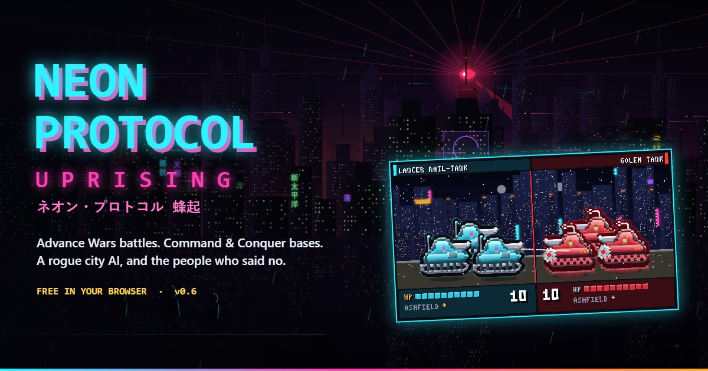

# Neon Protocol: Uprising

**[▶ Play it free](https://tristanhotham.com/games/neon-protocol/)**, in your browser, with nothing to install.



## About

A turn-based tactics game: Advance Wars battles with Command & Conquer base building, set in Shin-Pacifica, a coastal megacity in 2187. The city's defence AI, the Overmind, was built to manage the damage to a burned-out planet. It has done the arithmetic, and its answer is fewer people. You can fight it with the Resistance or take its side through the same war.

- Two five-act campaigns (Resistance and Overmind) with boss battles, weather, day and night, story choices and a named squad who carry their rank between missions
- Base building: capture city blocks for income, harvest Lumenite, build barracks, factories, airpads, docks, power, walls, turrets and superweapons
- Twelve generals, each with a passive bonus, a power and a super power
- Custom Battle from 1v1 to 4v4 with allies and co-op, Conquest, Horde mode and a Map Maker
- Mouse, keyboard, touch and controller; colour-blind palette, reduced motion and text scaling
- A 48-track soundtrack composed by Tristan Hotham
- Synthesised weapons, engines and voices for every unit, with Freesound recordings for explosions, ricochets, death cries, footsteps and ambience
- Varied death animations and unit chatter: Resistance street slang mixing English with Asian languages, and Overmind binary

This is version 0.6.1, an early build. The balance is still moving.

## How to play

- **Select** one of your units, then **move** it to a highlighted tile.
- **Attack** an enemy in range. The first click previews the damage; the second fires. The defender fires back if it can.
- **Capture** city blocks with infantry for income, and build new units at Fabricators, Airpads and Ports.
- Press **⚠** (or **T**) to show every visible enemy's reach at once. Tap a single enemy to see just its range.
- Fill your general's power meter by fighting, then use the power or super power.
- **End Turn** when you're done. Win by meeting the mission's objective, usually taking the enemy HQ or routing their army.

The Boot Camp missions teach one idea at a time, and the glossary in the pause menu explains the jargon. Progress saves in your browser only. No data is collected.

## Running it locally

The whole game is a single self-contained `index.html`, with the soundtrack in `music/` and the recorded sound effects in `sfx/` beside it. There is no build step and nothing to install.

Serve the folder over HTTP so the music can load, for example:

```
npx serve .
```

Then open the address it prints. Opening `index.html` straight from disk also works, but the music may not play.

## More games

See all my games at **[tristanhotham.com/games](https://tristanhotham.com/games/)**.

## Licence

The code is under the [MIT licence](LICENSE). The music and the recorded sound effects are not: see [CREDITS.md](CREDITS.md).
